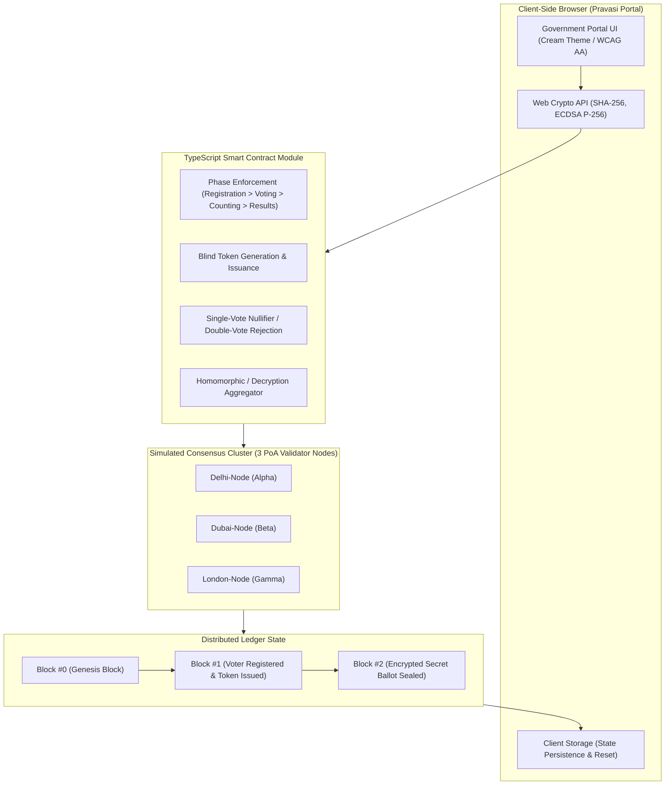

# Pravasi Matdan (प्रवासी मतदान)
### Blockchain-Based Remote E-Voting Prototype for Non-Resident Indians (NRIs)

> **Demonstration prototype - not an official election portal. All data is simulated.**  
> *Built with React, TypeScript, Tailwind CSS, Vite, and native WebCrypto API.*

---

## 🌟 Executive Overview
**Pravasi Matdan** is an end-to-end, cryptographically verifiable remote voting prototype engineered for Non-Resident Indians (NRIs) living across 25 host nations. It solves the democratic enfranchisement dilemma for over 32 million overseas citizens by allowing remote balloting with:
1. **Mathematical Ballot Secrecy**: Client-side encryption prevents any network observer or election authority from inspecting vote choices before tallying.
2. **Double-Voting Prevention**: Smart contract guarantees each anonymous voter token can cast exactly one ballot.
3. **End-to-End Verifiability (E2E-V)**: Voters receive a cryptographic receipt hash to independently verify their ballot was permanently included in the blockchain ledger without revealing their vote choice.
4. **Tamper-Evident Proof-of-Authority Ledger**: SHA-256 block header chaining and Merkle trees detect any unauthorized modifications instantly.

---

## 🚀 Quick Start (Single Command)

### 1. Installation & Running
```bash
# Install dependencies
npm install

# Start local development server
npm run dev
```

Open your browser at `http://localhost:5173/` (or the URL displayed in your terminal).

### 2. Running Unit Tests
```bash
npm test
```
Runs the automated Vitest suite verifying:
- SHA-256 hashing and Merkle root calculation
- Chain integrity validation on genuine blocks
- Smart contract double-voting rejection
- Tamper detection and authentic ledger restoration

---

## 🔑 Demo Credentials

| Role | Username / Identifier | Passphrase / Key | Sample Pre-Seeded Profiles |
| :--- | :--- | :--- | :--- |
| **Election Officer (Admin)** | `admin` | `admin123` | Direct full administrative control |
| **Demo Voter 1** | `NRI-IND-7001` | Any 6-digit OTP (e.g. `123456`) | **Rohan Narang** (Varanasi, UAE) |
| **Demo Voter 2** | `NRI-IND-7002` | Any 6-digit OTP (e.g. `123456`) | **Dr. Ananya Iyer** (Thiruvananthapuram, UK) |
| **Demo Voter 3** | `NRI-IND-7003` | Any 6-digit OTP (e.g. `123456`) | **Vikramjit Singh Sandhu** (Amritsar, Canada) |
| **Demo Voter 4** | `NRI-IND-7004` | Any 6-digit OTP (e.g. `123456`) | **Karthik Balasubramanian** (Bangalore South, USA) |

*Tip: Click the **"Quick Login as Demo Voter"** or **Demo Guide** shortcuts on the screen for instant access without manual typing.*

---

## 🏛️ System Architecture



---

## ⏱️ 5-Minute Presentation Demo Script

### Minute 1: The NRI Enfranchisement Challenge & Landing Page
1. Introduce the portal: Point out the government cream aesthetic (`#FAF3E0`), the top saffron-white-green strip, accessibility controls (`A- A A+`, High-contrast, Hindi/English toggle), and the visible simulation disclaimer.
2. Note the live statistics strip (registered voters, votes cast, blocks mined, turnout) powered live by the blockchain.
3. Open the floating **"Demo Guide"** panel in the bottom-right corner.

### Minute 2: Overseas Voter Registration (Form 6A)
1. Click **"Register as Overseas Voter"** (or use Step 1 in Demo Guide).
2. Click **"Auto-fill Demo Data"** to instantly populate passport details, 25-country residence dropdown, and home constituency.
3. Advance through Document uploads to Step 4:
   - Click **"Start 3-Second Liveness Scan"** to show animated webcam depth scan.
   - Click **"Request OTP"** to demonstrate simulated mobile dispatch (visible in the top **Outbox**).
4. Click **"Submit Form 6A Application"** to generate the official Application Reference ID and printable acknowledgement.

### Minute 3: Election Officer Portal & Cryptographic Key Generation
1. Navigate to **Election Officer** (`/admin`), log in with `admin123`.
2. In the **Applications Queue**, click **"Review"** on the submitted application.
3. Inspect document previews, then click **"Approve & Generate On-Chain Keys"**:
   - The browser computes a real WebCrypto **ECDSA P-256 keypair**.
   - The public key and a SHA-256 identity hash (zero raw PII) are sealed into a `VOTER_REGISTERED` block.
   - An anonymous voting token commitment is issued via `TOKEN_ISSUED`.
4. Switch to the **Election Phase Control** tab and click **"Switch to VOTING"**.

### Minute 4: Casting Secret Ballot & Double-Voting Guard
1. Navigate to the **Voter Portal & Booth** (`/voter`).
2. Log in using `NRI-IND-7001` (or click Quick Demo Voter shortcut).
3. The electronic ballot displays candidates with party symbols and the constitutional NOTA option.
4. Select a candidate and click **"Sign & Cast Ballot"**:
   - Watch the 4-step cryptographic pipeline animation: *Encrypting ballot* > *Signing with ECDSA* > *Broadcasting to validator nodes* > *PoA Block Mined*.
   - Confetti triggers upon confirmation!
5. Inspect the official **Vote Receipt** with transaction hash, block number, validator attribution, and QR code.
6. **Key Acceptance Check**: Click **"Attempt Second Vote (Test Guard)"** to show immediate smart contract rejection preventing double voting.

### Minute 5: Public Verification, Tamper Test Showcase & Results
1. Click **"Verify Vote"** (`/verify`), click **"Auto-Paste Latest Vote Receipt Hash"**, and hit **"Verify Receipt"**:
   - Demonstrates that the ballot is included in the block with multiple confirmations, while strictly keeping candidate choice confidential.
2. Go to **Blockchain Explorer** (`/explorer`):
   - Click **"Simulate Database Tamper (Break Chain)"**:
   - The integrity indicator immediately turns RED (`TAMPER DETECTED at Block #1`), showing how SHA-256 chaining catches unauthorized alterations.
   - Click **"Restore Authentic Ledger"** to restore consensus state.
3. Switch phase to **"RESULTS_DECLARED"** (via Demo Guide or Admin) and open **Election Results** (`/results`):
   - Show constituency candidate bar charts, turnout by host country, and winner ribbons.
   - Click **"Cryptographically Re-Verify Tally Against Chain"** to show real-time on-chain tally reconciliation.

---

## 🛡️ Security & Privacy Design
- **Zero PII on Chain**: Only SHA-256 hashes of passport credentials are saved to the distributed ledger.
- **Voter Anonymity**: Ballots are unlinked from identity using single-use cryptographic tokens.
- **Client-Side Cryptography**: Key pairs and signatures utilize standard W3C `SubtleCrypto` primitives (ECDSA P-256 with SHA-256).

---

## 📄 License
Demonstration Prototype for educational, research, and showcase purposes.
